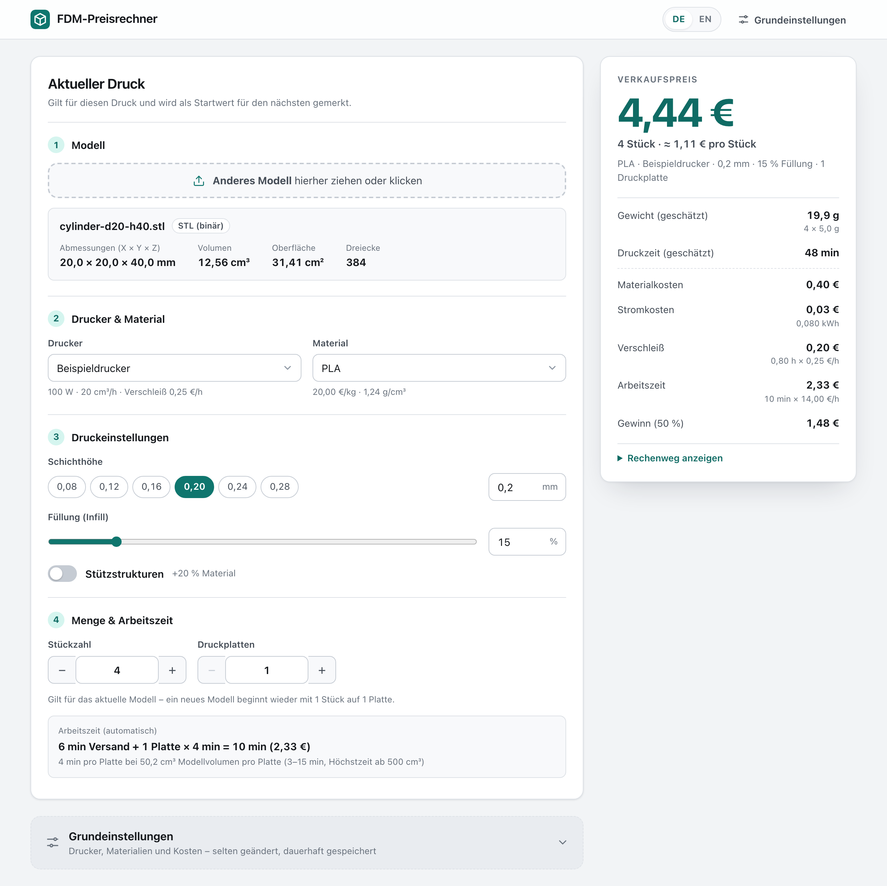

# FDM-Preisrechner

Lokale Web-App, die aus einem 3D-Modell (STL, 3MF oder OBJ) schätzt, zu welchem Preis du einen FDM-Druck anbieten kannst – ohne Slicer, mit nachvollziehbarer Rechnung.

*English version: [README.md](README.md)*



- **Modell hineinziehen** (STL, 3MF oder OBJ): Abmessungen, Volumen und Oberfläche erscheinen sofort.
- **Drucker, Material und Druckeinstellungen wählen** – der Preis ändert sich bei jeder Eingabe.
- **Alle Kosten eingerechnet:** Material, Strom, Verschleiß und Arbeit, dazu deine Gewinnmarge.
- **Stückzahl und Druckplatten:** mehrere gleiche Teile aus einer Datei berechnen, die Arbeitszeit ergibt sich automatisch.
- **Deutsch und Englisch:** Sprache oben rechts umschalten.
- **Läuft nur auf deinem Computer.** Kein Konto, keine Cloud, keine Abhängigkeiten. Die Einstellungen bleiben bei dir.

## Installation

Voraussetzung ist [Node.js](https://nodejs.org) ab Version 22. Weitere Pakete braucht es nicht, also auch kein `npm install`.

```bash
git clone https://github.com/JakobFPV/fdm-preisrechner.git
cd fdm-preisrechner
npm start
```

Ohne Git: auf GitHub *Code → Download ZIP*, entpacken und im entpackten Ordner `npm start` ausführen.

Getestet unter macOS. `npm start` braucht nur Node.js und sollte deshalb auch unter Windows und Linux laufen. Start per Doppelklick und Autostart gibt es nur für macOS.

## Starten

```bash
npm start
```

Der Rechner läuft dann unter **http://localhost:3141** und öffnet sich im Standardbrowser. Beenden mit `Ctrl+C` im Terminal.

- **Ohne Terminal (macOS):** Doppelklick auf `start.command`. Beenden: Terminalfenster schließen. Wurde der Ordner als ZIP heruntergeladen, blockiert macOS das Skript beim ersten Mal: dann Rechtsklick → *Öffnen*.
- **Anderer Port:** `PORT=3142 npm start`
- Läuft er schon, öffnet ein zweiter Start einfach die Seite.
- Erreichbar ist er nur auf diesem Computer (127.0.0.1), nicht im Netzwerk.

### Immer verfügbar, wie eine App (macOS)

```bash
npm run autostart:install
```

Der Preisrechner läuft dann dauerhaft im Hintergrund und startet beim Anmelden automatisch. Für ein App-Fenster ohne Browserleisten http://localhost:3141 öffnen und dann:

- **Safari:** *Ablage → Zum Dock hinzufügen*. Die App liegt danach im Dock und unter `~/Applications` (im Finder „Programme“).
- **Chrome / Brave:** Browsermenü → *Speichern und teilen* (in Chrome: *Streamen, speichern und teilen*) → *Seite als App installieren*.

Prüfen mit `npm run autostart:status`, entfernen mit `npm run autostart:uninstall`. Das Log liegt unter `~/Library/Logs/fdm-preisrechner.log`. Nach dem Verschieben des Projektordners `npm run autostart:install` noch einmal ausführen.

Liegt der Projektordner auf dem Schreibtisch oder in „Dokumente“, kann macOS dem Hintergrunddienst den Zugriff verweigern („Operation not permitted“ im Log). Dann den Ordner z. B. in den Benutzerordner verschieben und den Autostart neu einrichten.

## Bedienung

1. Modell in das Feld ziehen (oder klicken und Datei wählen). Abmessungen, Volumen und Oberfläche erscheinen sofort.
2. Drucker, Material, Schichthöhe, Füllung und Stützstrukturen wählen. Der Verkaufspreis rechts ändert sich bei jeder Eingabe.
3. **Stückzahl** (gleiche Teile aus derselben Datei) und **Druckplatten** einstellen. Die Arbeitszeit wird daraus automatisch berechnet.
4. **Grundeinstellungen** (unten, eingeklappt): Drucker, Materialien, Strompreis, Stundenlohn, Gewinnmarge, Stützmaterial-Zuschlag, Wandstärke und die Regeln für die Arbeitszeit anlegen und ändern.

Drucker, Material, Schichthöhe, Füllung und Stützen werden gemerkt und beim nächsten Mal vorausgewählt. Stückzahl und Druckplatten gelten nur für das aktuelle Modell: Jedes neue Modell beginnt wieder mit 1 Stück auf 1 Platte.

**Sprache:** Oben rechts mit **DE | EN** zwischen Deutsch und Englisch wechseln. Die Wahl wird mit den Einstellungen gespeichert. Beim allerersten Start wählt der Rechner Deutsch oder Englisch anhand der Spracheinstellungen des Browsers. Meldungen im Terminal erscheinen je nach Systemsprache und auf der Seite gewählter Sprache auf Deutsch oder Englisch.

## So wird gerechnet

| Schritt | Formel |
|---|---|
| Wände | min(Modellvolumen, Oberfläche × Wandstärke) |
| Füllung | (Modellvolumen − Wände) × Füllung % |
| Stützen | (Wände + Füllung) × Stützmaterial-Zuschlag % – nur wenn Stützstrukturen an sind |
| Gewicht | Materialvolumen pro Stück × Stückzahl × Dichte |
| Druckzeit | Materialvolumen pro Stück × Stückzahl ÷ (Durchsatz × Schichthöhe ÷ 0,2 mm) |
| Materialkosten | Gewicht × Preis pro kg |
| Stromkosten | Leistung × Druckzeit × Strompreis |
| Verschleiß | Druckzeit × Verschleiß des Druckers (€ pro Druckstunde) |
| Zeit pro Platte | Mindestzeit + (Höchstzeit − Mindestzeit) × Modellvolumen pro Platte ÷ „Höchstzeit ab“, höchstens die Höchstzeit, auf ganze Minuten gerundet |
| Arbeit | (Versand + Druckplatten × Zeit pro Platte) × Stundenlohn |
| **Verkaufspreis** | **(Material + Strom + Verschleiß + Arbeit) × (1 + Gewinnmarge %)** |

Die **Wände** (Außenwände, Boden, Deckel) werden immer voll gedruckt, die Füllung nur anteilig. Deshalb bestehen kleine Modelle überwiegend aus Wand, große überwiegend aus Füllung.

Der **Durchsatz** eines Druckers gilt für 0,2 mm Schichthöhe. Dünnere Schichten fördern weniger Material pro Stunde und dauern entsprechend länger.

Die **Arbeitszeit** wird automatisch berechnet:

- **Versand:** einmal pro Auftrag, Standard 6 min.
- **Pro Druckplatte:** Zeit zum Abnehmen und Nacharbeiten, Standard 3 bis 15 min. Sie richtet sich nach dem Modellvolumen auf der Platte (Volumen × Stück pro Platte). Ab 500 cm³ pro Platte gilt die Höchstzeit.

Alle vier Werte lassen sich in den Grundeinstellungen unter „Arbeitszeit“ ändern. Bezahlt wird die Arbeit mit dem **Stundenlohn** (Standard 14,00 €/h).

Den **Verschleiß** (Düse, Riemen, Druckplatte, Abschreibung) hat jeder Drucker selbst als Betrag pro Druckstunde (Standard 0,25 €/h). Die **Gewinnmarge** kommt auf alle Kosten drauf, also auch auf Arbeit und Verschleiß.

Der **Verkaufspreis** ist der exakte Wert, auf den Cent gerundet. Die Aufschlüsselung ist so gerundet, dass sie genau auf diesen Preis aufgeht. Unter „Rechenweg anzeigen“ stehen alle Zwischenwerte.

Beispiel mit den Standardwerten: Der 20-mm-Testwürfel hat 8 cm³ Volumen und 24 cm² Oberfläche.

- Wände: 24 cm² × 0,08 cm = 1,92 cm³
- Füllung: 6,08 cm³ × 15 % = 0,91 cm³
- Gewicht: 2,83 cm³ × 1,24 g/cm³ = 3,5 g, kostet bei PLA zu 20 €/kg 0,070 €
- Druckzeit: 2,83 cm³ ÷ 20 cm³/h ≈ 8 min (0,14 h)
  - Strom: 100 W → 0,014 kWh = 0,005 €
  - Verschleiß: 0,14 h × 0,25 €/h = 0,035 €
- Arbeit: 6 min Versand + 1 Platte × 3 min (nur 8 cm³ auf der Platte) = 9 min × 14 €/h = 2,10 €
- Preis: (0,070 € + 0,005 € + 0,035 € + 2,10 €) × 1,5 = **3,32 €**

Derselbe Würfel 10-mal auf 2 Platten: 40 cm³ pro Platte ergeben 4 min pro Platte, also 6 + 2 × 4 = 14 min Arbeit. Mit dem zehnfachen Material kostet das **6,56 €**, rund 0,66 € pro Stück.

Bei kleinen Drucken macht die Arbeitszeit also den größten Teil des Preises aus.

### Drucker-Werte ermitteln

- **Durchsatz (cm³/h):** Den Slicer einen typischen Druck bei 0,2 mm schneiden lassen. Beispiel: 50 g PLA in 2 h 30 min ergibt 50 ÷ 1,24 = 40,3 cm³, geteilt durch 2,5 h = **16 cm³/h**.
- **Leistung (W):** Mit einem Steckdosen-Messgerät messen, kWh eines Drucks ÷ Druckstunden × 1000. Beispiel: 0,25 kWh in 2,5 h = **100 W**.
- **Verschleiß (€/h):** (Druckerpreis + Ersatzteile über die Lebensdauer) ÷ erwartete Druckstunden. Beispiel: (800 € + 400 €) ÷ 5000 h = **0,24 €/h**.

### Grenzen der Schätzung

- Aufheizen, Brim, Spülmaterial und Fehldrucke sind nicht eingerechnet. Das deckt die Gewinnmarge ab.
- Gerechnet wird in Euro.
- Modelle müssen in Millimetern vorliegen (bei 3MF wird die Einheit der Datei umgerechnet).
- Ist ein Modell nicht geschlossen (Löcher), erscheint eine Warnung, weil das Volumen dann ungenau ist.

## Wo die Einstellungen gespeichert sind

Alles liegt als JSON auf der Festplatte im Ordner **`data/`** des Projekts. Der Ordner wird beim ersten Start angelegt:

| Datei | Inhalt |
|---|---|
| `data/settings.json` | Sprache, Drucker (mit Verschleiß), Materialien, Strompreis, Stundenlohn, Gewinnmarge, Stützmaterial-Zuschlag, Wandstärke, Regeln für die Arbeitszeit |
| `data/last-print.json` | zuletzt verwendeter Drucker, Material, Schichthöhe, Füllung und Stützen |

Weil der lokale Server diese Dateien schreibt (und nicht der Browser), bleiben die Einstellungen erhalten nach Neuladen, Neustart des Computers, Löschen der Browserdaten und beim Wechsel in einen anderen Browser. Den genauen Pfad zeigt auch die Seite unter „Grundeinstellungen“.

- **Backup:** den Ordner `data/` kopieren.
- **Wiederherstellen:** Preisrechner beenden, die Dateien zurück nach `data/` kopieren, neu starten.
- **Anderer Speicherort:** `DATA_DIR=/pfad/zum/ordner npm start`
- **Einstellungen aus einer älteren Version** werden automatisch mit den Standardwerten ergänzt und behalten die deutsche Oberfläche, bis du umschaltest.
- **Beschädigte Datei** (z. B. von Hand falsch bearbeitet): Sie wird als `settings.json.broken-…` aufbewahrt, es gelten wieder die Standardwerte, und die Seite zeigt einen Hinweis.

## Tests

```bash
npm test
```

Die Tests prüfen:

- **Rechnung:** 20-mm-Würfel mit 0 % und 100 % Füllung, mit und ohne Stützen, 0 % Marge, zwei Drucker mit unterschiedlicher Leistung und unterschiedlichem Durchsatz, Stückzahl und Druckplatten, automatische Arbeitszeit, Verschleiß, Rundung und die Beispiele oben
- **Einlesen:** STL (Binär und Text), OBJ, 3MF (Einheiten, Transformationen, Bambu-Studio-Aufbau) sowie kaputte und nicht unterstützte Dateien
- **Speicherung:** Werte überstehen einen Neustart, beschädigte Dateien werden aufbewahrt, ältere Einstellungen werden übernommen
- **Server:** API, Schutz vor Zugriffen von fremden Webseiten, Antworten in der angefragten Sprache
- **Sprachen:** Deutsch und Englisch enthalten dieselben Texte, und jeder Text, den die App verwendet, ist vorhanden

Beispielmodelle zum Ausprobieren liegen in `test-models/` (neu erzeugen mit `npm run test-models`):

| Datei | Erwartung |
|---|---|
| `cube-20mm.stl`, `cube-20mm-ascii.stl`, `cube-20mm.3mf` | 20 × 20 × 20 mm, 8,00 cm³ |
| `cylinder-d20-h40.stl` | Ø 20 × 40 mm, 12,56 cm³ |
| `box-60x40x10mm.obj` | 60 × 40 × 10 mm, 24,00 cm³ |
| `hollow-cube-40mm.stl` | 40 × 40 × 40 mm mit Hohlraum, 37,00 cm³ |
| `broken-truncated.stl`, `not-a-model.stl`, `broken.3mf`, `unsupported.step` | jeweils eine verständliche Fehlermeldung |

## Aufbau

```
server.js            Startpunkt (lokaler Webserver)
start.command        Start per Doppelklick (macOS)
src/                 Server: API und Speicherung der Einstellungen
public/              Oberfläche (HTML, CSS, JavaScript)
public/lib/calc.js   Preisberechnung
public/lib/mesh.js   Einlesen von STL, 3MF und OBJ
public/lib/i18n.js   deutsche und englische Texte
scripts/             Beispielmodelle erzeugen, Autostart (macOS)
test/                Tests
test-models/         Beispielmodelle
data/                deine Einstellungen (wird beim ersten Start angelegt, nicht in Git)
```

## Datenschutz

Der Rechner läuft nur auf deinem Computer und ist nur dort erreichbar (127.0.0.1). Modelle werden im Browser gelesen und nirgendwohin hochgeladen. Einstellungen landen ausschließlich in `data/`, das nicht in Git eingecheckt wird. Es gibt keine externen Abhängigkeiten, kein Tracking und keine Verbindungen ins Internet.

## Lizenz

[MIT](LICENSE)
