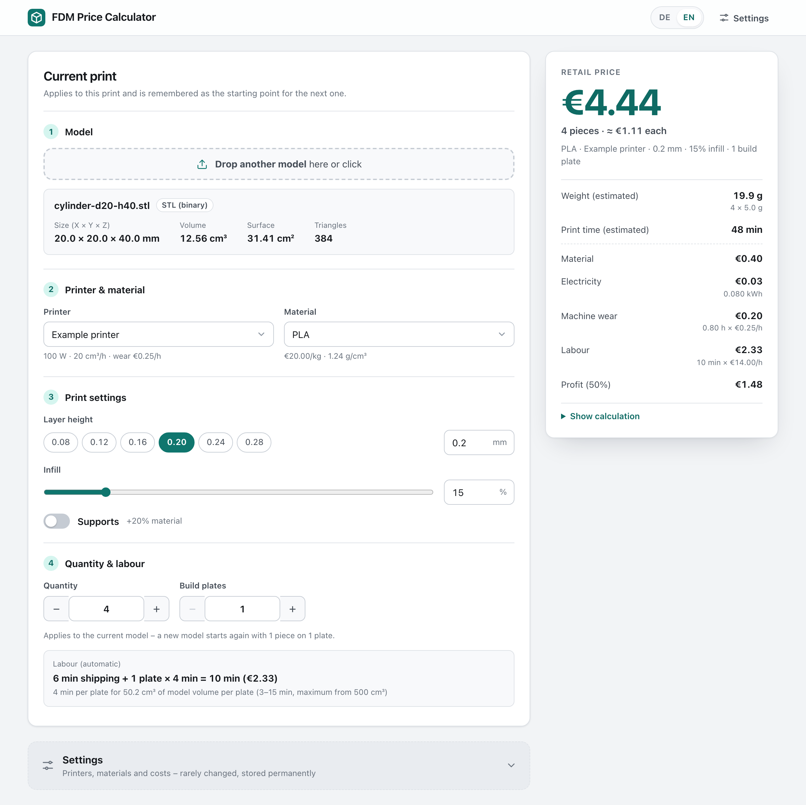

# FDM Price Calculator

A local web app that estimates the retail price of an FDM 3D print from an STL, 3MF or OBJ file – no slicer needed, with a calculation you can follow step by step.

*Deutsche Anleitung: [README.de.md](README.de.md)*



- **Drop in a model** (STL, 3MF or OBJ) and see its size, volume and surface right away.
- **Pick printer, material and print settings** – the price updates instantly.
- **Covers all costs:** material, electricity, machine wear and labour, plus your profit margin.
- **Quantity and build plates:** price several copies of the same file; labour is calculated automatically.
- **English and German:** switch the language in the top right corner.
- **Runs only on your computer.** No account, no cloud, no dependencies. Your settings are stored locally.

## Installation

You need [Node.js](https://nodejs.org) 22 or newer. Nothing else – no `npm install`.

```bash
git clone https://github.com/JakobFPV/fdm-preisrechner.git
cd fdm-preisrechner
npm start
```

Without Git: on GitHub choose *Code → Download ZIP*, unpack it and run `npm start` in the unpacked folder.

Tested on macOS. `npm start` only needs Node.js, so it should also work on Windows and Linux. Starting by double-click and the autostart are macOS only.

## Starting

```bash
npm start
```

The calculator then runs at **http://localhost:3141** and opens in your default browser. Stop it with `Ctrl+C` in the terminal.

- **Without a terminal (macOS):** double-click `start.command`. To stop it, close the Terminal window. If you downloaded the folder as a ZIP, macOS blocks the script the first time: right-click it → *Open*.
- **Another port:** `PORT=3142 npm start`
- If it is already running, starting it again simply opens the page.
- It is only reachable from your own computer (127.0.0.1), not from the network.

### Always available, like an app (macOS)

```bash
npm run autostart:install
```

The calculator then runs in the background and starts automatically when you log in. For an app window without browser bars, open http://localhost:3141 and then:

- **Safari:** *File → Add to Dock*. The app appears in the Dock and in `~/Applications`.
- **Chrome / Brave:** browser menu → *Save and share* (in Chrome: *Cast, save and share*) → *Install page as app*.

Check it with `npm run autostart:status`, remove it with `npm run autostart:uninstall`. The log is at `~/Library/Logs/fdm-preisrechner.log`. After moving the project folder, run `npm run autostart:install` again.

If the project folder is on the Desktop or in Documents, macOS may block the background service ("Operation not permitted" in the log). Move the folder, for example to your home folder, and set up the autostart again.

## Usage

1. Drop a model onto the page (or click and choose a file). Size, volume and surface appear right away.
2. Choose printer, material, layer height, infill and supports. The retail price on the right updates with every change.
3. Set the **quantity** (identical pieces from the same file) and the number of **build plates**. The labour time follows automatically.
4. **Settings** (at the bottom, collapsed): add and edit printers and materials, electricity price, hourly wage, profit margin, support surcharge, wall thickness and the labour rules.

Printer, material, layer height, infill and supports are remembered and preselected next time. Quantity and build plates belong to the current model: every new model starts again with 1 piece on 1 plate.

**Language:** switch between German and English with **DE | EN** in the top right corner. The choice is stored with the settings. On the very first start it picks German or English based on your browser's language settings. Messages in the terminal are in German or English, depending on your system language and the language chosen on the page.

## How the price is calculated

| Step | Formula |
|---|---|
| Walls | min(model volume, surface × wall thickness) |
| Infill | (model volume − walls) × infill % |
| Supports | (walls + infill) × support surcharge % – only with supports on |
| Weight | material volume per piece × quantity × density |
| Print time | material volume per piece × quantity ÷ (throughput × layer height ÷ 0.2 mm) |
| Material | weight × price per kg |
| Electricity | power × print time × electricity price |
| Machine wear | print time × the printer's wear cost (€ per print hour) |
| Time per plate | minimum + (maximum − minimum) × model volume per plate ÷ "maximum from", at most the maximum, rounded to whole minutes |
| Labour | (shipping + build plates × time per plate) × hourly wage |
| **Retail price** | **(material + electricity + wear + labour) × (1 + profit margin %)** |

The **walls** (perimeters, bottom and top) are always printed solid, the infill only partly. Small models are therefore mostly walls, large ones mostly infill.

A printer's **throughput** is given for 0.2 mm layers. Thinner layers move less material per hour and take correspondingly longer.

**Labour** is calculated automatically:

- **Shipping:** once per order, 6 min by default.
- **Per build plate:** time for removing and finishing the parts, 3 to 15 min by default. It depends on the model volume on the plate (volume × pieces per plate); from 500 cm³ per plate the maximum applies.

All four values can be changed under *Settings → Labour*. Labour is paid at the **hourly wage** (default €14.00/h).

Every printer has its own **machine wear** cost per print hour – nozzle, belts, build plate, depreciation (default €0.25/h). The **profit margin** is added on top of all costs, including labour and wear.

The **retail price** is the exact value rounded to the cent; the breakdown is rounded so that it adds up to exactly that price. *Show calculation* lists every intermediate value.

Example with the default settings – the 20 mm test cube has 8 cm³ volume and 24 cm² surface:

- Walls: 24 cm² × 0.08 cm = 1.92 cm³
- Infill: 6.08 cm³ × 15% = 0.91 cm³
- Weight: 2.83 cm³ × 1.24 g/cm³ = 3.5 g, which costs €0.070 at €20/kg PLA
- Print time: 2.83 cm³ ÷ 20 cm³/h ≈ 8 min (0.14 h)
  - Electricity: 100 W → 0.014 kWh = €0.005
  - Machine wear: 0.14 h × €0.25/h = €0.035
- Labour: 6 min shipping + 1 plate × 3 min (only 8 cm³ on the plate) = 9 min × €14/h = €2.10
- Price: (€0.070 + €0.005 + €0.035 + €2.10) × 1.5 = **€3.32**

The same cube 10 times on 2 plates: 40 cm³ per plate gives 4 min per plate, so 6 + 2 × 4 = 14 min of labour. With ten times the material that costs **€6.56**, about €0.66 per piece.

For small prints, labour is therefore the largest part of the price.

### Finding your printer's values

- **Throughput (cm³/h):** slice a typical print at 0.2 mm. Example: 50 g of PLA in 2 h 30 min is 50 ÷ 1.24 = 40.3 cm³, divided by 2.5 h = **16 cm³/h**.
- **Power (W):** measure with a plug-in power meter: kWh of a print ÷ print hours × 1000. Example: 0.25 kWh in 2.5 h = **100 W**.
- **Wear (€/h):** (printer price + spare parts over its lifetime) ÷ expected print hours. Example: (€800 + €400) ÷ 5000 h = **€0.24/h**.

### Limits of the estimate

- Heating up, brims, purge material and failed prints are not included – the profit margin covers them.
- Prices are calculated in euros.
- Models must be in millimeters (3MF files are converted from their own unit).
- If a model is not closed (holes), a warning appears, because its volume is then inaccurate.

## Where the settings are stored

Everything is stored as JSON on disk, in the project's **`data/`** folder. It is created on the first start:

| File | Contents |
|---|---|
| `data/settings.json` | language, printers (with wear), materials, electricity price, hourly wage, profit margin, support surcharge, wall thickness, labour rules |
| `data/last-print.json` | last used printer, material, layer height, infill and supports |

Because the local server writes these files (not the browser), your settings survive reloading the page, restarting the computer, clearing browser data and switching browsers. The page shows the exact path under *Settings*.

- **Backup:** copy the `data/` folder.
- **Restore:** stop the calculator, copy the files back into `data/`, start it again.
- **Different location:** `DATA_DIR=/path/to/folder npm start`
- **Settings from an older version** are completed with the default values automatically and keep the German interface until you switch.
- **Damaged file** (e.g. after a manual edit): it is kept as `settings.json.broken-…`, the default values apply again and the page shows a notice.

## Tests

```bash
npm test
```

The tests cover:

- **Calculation:** the 20 mm cube with 0% and 100% infill, with and without supports, 0% margin, two printers with different power and throughput, quantity and build plates, automatic labour, machine wear, rounding and the examples above
- **Reading models:** STL (binary and text), OBJ, 3MF (units, transforms, Bambu Studio projects) and broken or unsupported files
- **Storage:** values survive a restart, damaged files are kept, older settings are migrated
- **Server:** API, protection against requests from other websites, answers in the requested language
- **Languages:** German and English contain the same texts, and every text the app uses exists

Sample models to try are in `test-models/` (recreate them with `npm run test-models`):

| File | Expected result |
|---|---|
| `cube-20mm.stl`, `cube-20mm-ascii.stl`, `cube-20mm.3mf` | 20 × 20 × 20 mm, 8.00 cm³ |
| `cylinder-d20-h40.stl` | Ø 20 × 40 mm, 12.56 cm³ |
| `box-60x40x10mm.obj` | 60 × 40 × 10 mm, 24.00 cm³ |
| `hollow-cube-40mm.stl` | 40 × 40 × 40 mm with a cavity, 37.00 cm³ |
| `broken-truncated.stl`, `not-a-model.stl`, `broken.3mf`, `unsupported.step` | a clear error message each |

## Project structure

```
server.js            entry point (local web server)
start.command        start by double-click (macOS)
src/                 server: API and settings storage
public/              user interface (HTML, CSS, JavaScript)
public/lib/calc.js   price calculation
public/lib/mesh.js   reading STL, 3MF and OBJ
public/lib/i18n.js   German and English texts
scripts/             sample models, autostart (macOS)
test/                tests
test-models/         sample models
data/                your settings (created on the first start, not in Git)
```

## Privacy

The calculator runs only on your computer and is only reachable there (127.0.0.1). Models are read in the browser and uploaded nowhere. Settings are written only to `data/`, which is not checked into Git. There are no external dependencies, no tracking and no connections to the internet.

## License

[MIT](LICENSE)
